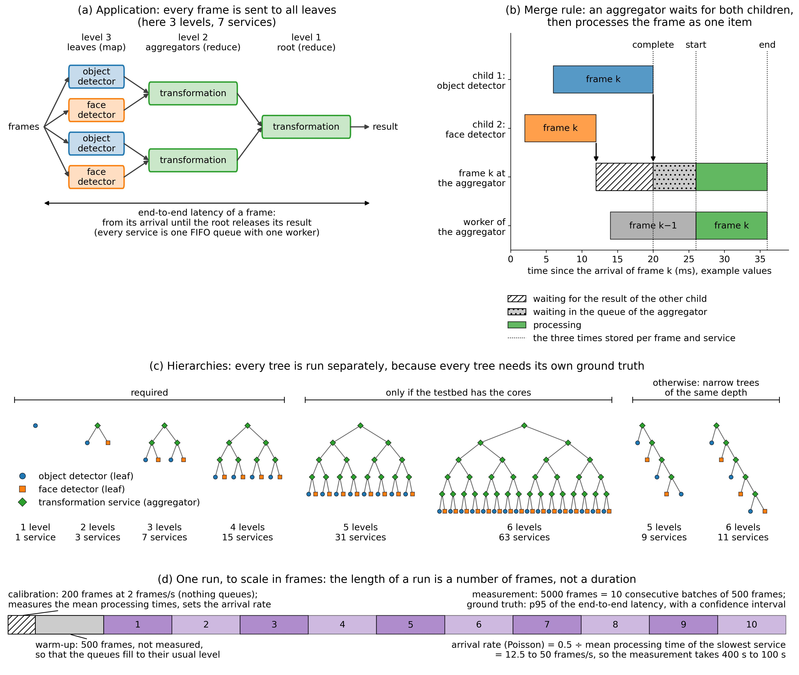

The evaluation notebook [2_evaluation.ipynb](2_evaluation.ipynb) already carries most of the experiments needed for the 
paper, however, we need new data. For  this we use the existing structure, run some new experiments in the background, 
and swap the data. In particular, we need the following experiments and also a folder structure that follow this.

Importantly, the services must now support a queue each that accumulates frames until infinity if they are not processed
and also each frame is released immediately (or reported in our simulation) to the next service. This we can simulate 
through a counter of how many data frames are supposedly in the queue: each service starts from 0, and as soon as there
are frames in the queue, the workers collect them one by one to process them.

The standard case is that we have an arrival rate that sits around 50% utilization and poisson arrivals, so there is queuing.

50% utilization would be that processing at the slowest service takes 10ms, and we have an arrival every 20ms at the first service.

### B1 (Base Case)

We need three types of applications, with at least 5 instances (i.e., different service chains) each. I want one Computer
Vision (CV) application, one that does audio processing, and another one that does Lidar or some other sort of other data.
The idea is that we have 5 instances of each application that consist of different services (e.g., detectors, processors),
and we predict the performance of this chain while using only the data from the other 4 instances (folds). This means that
every service must appear in at least 2 different instances so that we have runtime data available.
No individual benchmarks are required anymore. We need at least 100/200/300 runs per instance, we can add more later.

Ideally chains are around 3 to 6 services long.

Chain 1: (object detection (Yolo n up to l)) --> transformation
Chain 2: (face detector (models 1,2,3,4)) --> transformation
Chain 5: object --> face; both are already known from the other

Ideally we create application instances where each service has a quality knobs, and we always tune it to the same value.
This means that in the CV or the audio applications, we have a resolution that determines every step, and the whole chain
is always configured in one quality. So for instance, in run #1, we configure the CV pipeline to work with 500px across
all services, and in run #2 we choose 700px. As before, we can draw these configurations through random uniform sampling,
but just as a constraint that within one run, all services have the same quality level.

### B2 (Varying levels of evidence)

Can be answered with B1 already.

### B3 (Varying depth)

*Overview of the experiment, drawn by [figure_b3_experiment.py](figure_b3_experiment.py)
([pdf](../../figures/tsc/b3_experiment_setup.pdf)); the paragraphs below give the details of every panel.*
- *(a) Application.* Boxes are services and arrows show where a result goes; the example tree has three levels. An
  arriving frame goes to all leaves (detectors) at once, and every transformation service merges the results of its
  two children.
- *(b) Merge rule.* A timeline of one frame, called frame k, at one aggregator, with example times in milliseconds
  on the horizontal axis. The two upper rows show when each child processes frame k, the third row what happens to
  frame k at the aggregator, and the fourth row what the worker of the aggregator is busy with. Look at the third
  row: frame k first waits for the result of the slower child, then in the queue until the worker has finished the
  frame before, and is then processed once, as one item. The three dotted lines are the times that are stored.
- *(c) Hierarchies.* Every small tree is one hierarchy that is run on its own, with its number of levels and services
  below it; the narrow trees on the right replace the two largest trees if the testbed has too few cores.
- *(d) One run.* A bar whose length is the number of frames of a run, to scale: calibration, warm-up, and the measured
  frames in their consecutive batches.

**Application: hierarchical camera analytics (map-reduce style).** It reuses the services of the CV application of B1,
so no new services are needed.

- *Leaves (map):* the detectors of B1, alternating between the object detector (Yolo n up to l) and the face detector.
- *Inner nodes and root (reduce):* the transformation service of B1, used as an aggregator: it merges the results of
  its two children into one result and passes that result on.
- *Item:* one frame, identified by a frame id. An arriving frame is sent to all leaves at the same moment. The
  end-to-end latency of a frame is the time from its arrival until the root releases its result.

**Merge rule (must be exactly this).** An aggregator *waits for the results of both children for the same frame id* and
then processes them as one item, in the order of the frame ids. One frame therefore gives one item at every service, and
every service sees the same arrival rate. This is the rule of map-reduce and of hierarchical FL (wait for all updates
of a round). The alternative, where every child result queues as its own item, doubles the arrival rate at every level
and overloads the root, so we do not use it. As everywhere else, every service is one FIFO queue with one worker.

**Hierarchies to run.** Balanced trees in which every aggregator has two children, with 1 to 6 levels. A tree with $L$
levels has $2^L - 1$ services: 1, 3, 7, 15, 31 and 63. Every tree is run separately, because we need its own ground
truth.
- Levels 1 to 4 (up to 15 services) are required.
- Levels 5 and 6 (31 and 63 services) only if the testbed has the cores for them. If it does not, replace them by a
  *narrow* tree of the same depth: at every level the aggregator joins the result of the level below with one new leaf.
  A narrow tree with $L$ levels has $2L - 1$ services (9 and 11 for 5 and 6 levels) and still has a path of $L$ services
  and $L - 1$ merges, which is what the depth experiment needs.

**Configuration per run.** As in B1: drawn uniformly at random; one quality level (i.e., CV resolution) for all services.

**Load.** Poisson arrivals at 50% utilization of the slowest service (needs again a quick calibration phase).

**Run length.** Roughly 5,000 frames per run; this means we'd get 250 frames beyond the 95th percentile.

**Number of runs.** 100 runs per hierarchy.

**What to store per run.** The same files as before, with these additions:
- per frame and service: the time the item was complete at the service (both child results there), the start and the
  end of its processing; from these we get the waiting for the other branch, the waiting in the queue and the
  processing time;
- per frame: the arrival time and the time the root released the result;
- per run: the topology as a list of edges, the configuration of every service, the arrival rate that was set, and the
  number of rows of every csv file in `summary.json`. Several files of the last copy were cut off in the middle of a
  line, and with the row count we notice that.

### B4 (Varying arrival rates and pattern)

This is an extension of B1, because we select one application (e.g., the CV) and conduct an experiment with different
arrival rates and pattern. This means we sweep the lambda arrivals from low to high utilization, e.g., from 0.1 up to 1.0,
with 3 to 4 ticks. Additionally, in a separate experiment, we sweep also the squared coefficient of arrivals so that we either 
have completely periodic arrivals (Ca² = 0), periodic with some jitter(Ca² = 0.3), poisson (Ca² = 1) or batches with (Ca² = 2 or 4).

### B5 (Varying tail behavior)

Skipped for now.

### B6 (Varying percentiles)

Can be answered with B1 already.

### C1 ()

Can be answered with B1 already.

### C2 ()

Can be answered with B1 already.